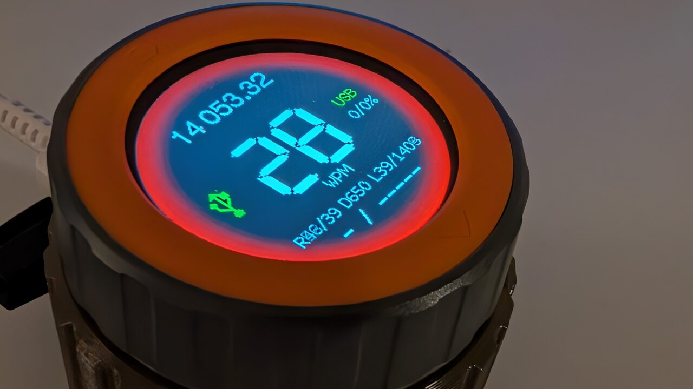

# Paddle2IP

<p align="center">
  
  <a href="https://youtu.be/FQNfEtQJDpA" title="Paddle2IP video on YouTube"></a>
</p>
<p align="center"><a href="https://youtu.be/FQNfEtQJDpA">&#9654; Video on YouTube</a></p>

Remote CW paddle over IP. Paddle2IP runs on an **M5Stack Dial v1.1** (ESP32-S3):
you plug a paddle into it, it keys a local iambic keyer with zero-latency
sidetone, and sends the **key edges with their exact timestamps** over WiFi/UDP
to a server at the transceiver. The server replays every edge a fixed time
later (the playout delay), so the marks and spaces on air are as long as the
keyer made them, whatever the network jitter is.

Supported servers:

| Server | Device | Notes |
|---|---|---|
| **Open Interface III (OI3)**, https://github.com/ok1hra/oi3 | OI3 interface board (ATmega2560 + W5500), keys the CW line through its PTT sequencer (`rkey.ino`) | reference implementation |
| **WIFILT**, https://github.com/ok1hra/wifilt | web interface for Icom LAN transceivers (ESP32, or a native program on a PC) | implemented and tested; keys TRX1 either through the radio's own keyer (CI-V text, no cable, one character late) or through the KEY output of the interface box (cable to the key jack, the operator's own timing). Setup: WIFILT [SOFTWARE.md, 9.8 Remote CW key](https://github.com/ok1hra/wifilt/blob/main/SOFTWARE.md#98-remote-cw-key) |

Any other device can be a server; see [Implementing a server](#implementing-a-server).

```
paddle ─► Paddle2IP: iambic keyer ─► sidetone (buzzer / headphones, 0 ms)
                      │ KEY: edges (t_us, up/down), 8× redundant, SipHash tag
                      ▼ UDP 5690
          server (OI3, WIFILT): jitter buffer ─► CW key line (+ PTT sequencer)
                      │ STATUS: nonce, RTT echo, rig freq/mode, counters
                      ▼
          Paddle2IP display: WPM, link, delay, rig freq/mode, WiFi signal
```

> Status: the firmware builds and its keyer, protocol and test tools are
> verified on a PC; it has **not been tested on hardware yet**.

## Quick start

1. **Paddle**: dit to Port B **G2**, dah to **G1**, common to **GND**
   (do not connect the red 5 V wire). See [Hardware](#hardware).
2. **Flash**: open the web flasher **https://ok1hra.github.io/paddle2ip/** in
   Chrome or Edge, connect the Dial with a USB-C data cable and click
   *Flash firmware*.
3. **Setup**: after the first start the display shows **SETUP**. Join the WiFi
   `Paddle2IP-XXXX` (password `paddle2ip`) with a phone; the setup page opens
   by itself (otherwise http://192.168.4.1). Enter your WiFi, the server
   address (port 5690) and the shared key — *Generate new key* shows a
   `[RkeyKey=...]` line for the server. *Save*.
4. **Server**: OI3 — put `[RkeyEnable=1]` and the same `[RkeyKey=...]` in
   `oi3.cfg` on the SD card and restart it. WIFILT — SETUP → *Remote CW key*:
   *Accept a Paddle2IP* on, choose *Keying*, paste the same key (the whole
   `[RkeyKey=...]` line works too), *Save & Restart*.
5. **Key**: the ring turns green when the server answers. Turn the knob for
   WPM, a short press selects the next function (tone, volume, delay, iambic
   A/B, rotation, test, info), a long press shows the service page.

Details: [First setup](#first-setup), [Operation](#operation).

## Contents

- [Quick start](#quick-start)
- [Hardware](#hardware)
  - [Ports A and B](#ports-a-and-b)
  - [Paddle wiring (Port B)](#paddle-wiring-port-b)
  - [Straight key and headphones (Port A, optional)](#straight-key-and-headphones-port-a-optional)
- [Build and flash](#build-and-flash)
- [First setup](#first-setup)
- [Operation](#operation)
  - [Screens](#screens)
  - [Encoder and button](#encoder-and-button)
  - [Setup mode](#setup-mode)
  - [WiFi](#wifi)
  - [USB network](#usb-network)
  - [Web page](#web-page)
  - [Serial console](#serial-console)
  - [Choosing the playout delay](#choosing-the-playout-delay)
  - [Access from the internet (NAT)](#access-from-the-internet-nat)
- [Testing without a rig](#testing-without-a-rig)
- [Firmware structure](#firmware-structure)
- [Implementing a server](#implementing-a-server)

## Hardware

| What | Where | Notes |
|---|---|---|
| Paddle dit | Port B **G2** (pin 2, white) | paddle common to GND; internal pull-up |
| Paddle dah | Port B **G1** (pin 1, yellow) | swap on the web page if needed |
| Paddle filter | at the connector | 100 Ω in series with each contact, 10 nF to GND, see [Paddle wiring](#paddle-wiring-port-b) |
| Straight key (optional) | Port A **G13** (pin 2, white) | to GND, enable on the web page |
| Headphone tone (optional) | Port A **G15** (pin 1, yellow) | PWM square wave: RC low-pass + series resistor, enable on the web page, see [Straight key and headphones](#straight-key-and-headphones-port-a-optional) |
| Sidetone | internal buzzer G3 | LEDC square wave at the tone frequency; volume 0–100 is mapped to the duty (max 50 %) so that every step of 5 is 2 dB (0 = off) |
| Encoder / button | G40/G41, G42 | |

**Do not connect the red 5 V wire** of the Grove cable to the paddle.
The Dial keeps itself powered from the battery (HOLD = GPIO46, set by `M5Dial.begin()`).

### Ports A and B

Both ports are Grove (HY2.0-4P, 2.0 mm pitch) sockets. Pin order of the
plug, the same on both ports:

```
         Port B  (paddle)                    Port A  (optional)
   ┌──────┬──────┬──────┬──────┐       ┌──────┬──────┬──────┬──────┐
   │  1   │  2   │  3   │  4   │       │  1   │  2   │  3   │  4   │
   │  G1  │  G2  │  5V  │ GND  │       │ G15  │ G13  │  5V  │ GND  │
   └──────┴──────┴──────┴──────┘       └──────┴──────┴──────┴──────┘
    yellow white   red   black          yellow white   red   black
     dah    dit    n.c. common          phones  str.   n.c.  GND
                                        tone    key
```

The wire colours are those of the standard Grove cable; check them on yours
with a multimeter (pin 4 = GND = the metal shell of the USB-C connector).
On Port A the I²C names are SCL = G15 (pin 1) and SDA = G13 (pin 2); the
firmware does not use I²C there.

### Paddle wiring (Port B)

```
 paddle jack 3.5 mm                          Dial Port B
                                             pin  wire    GPIO
 tip     dit ───[100 Ω]──────────┬────────── 2    white   G2
                                ═╧═
                                ═╤═ 10 nF
 sleeve  common ─────────────────┼────────── 4    black   GND
                                ═╧═
                                ═╤═ 10 nF
 ring    dah ───[100 Ω]──────────┴────────── 1    yellow  G1

                                             3    red     5 V  not connected
```

- Contacts close to GND; G1/G2 have the ESP32 internal pull-ups, no
  external resistor to 3.3 V is needed.
- The 100 Ω + 10 nF filter (at the Dial end of the cable) keeps RF and
  contact bounce out of the GPIOs. Without it the paddle works too, but put it
  there near a transmitter.
- Tip = dit, ring = dah is the usual jack wiring; if your paddle is wired the
  other way round, set *paddle swap* on the web page instead of rewiring.

### Straight key and headphones (Port A, optional)

```
 straight key                                Dial Port A
                                             pin  wire    GPIO
 key ───────────[100 Ω]──────────┬────────── 2    white   G13  (enable "straight key")
                                ═╧═
                                ═╤═ 10 nF
 key common ─────────────────────┴────────── 4    black   GND

 headphones 3.5 mm (example values)          pin  wire    GPIO
 tip + ring ───┤├+───[470 Ω]───┬──[1 kΩ]──── 1    yellow  G15  (enable "headphone tone")
              10 µF           ═╧═
                              ═╤═ 100 nF
 sleeve ───────────────────────┴──────────── 4    black   GND
```

- The straight key closes to GND like the paddle (internal pull-up) and keys
  with its own timing; it works only when enabled on the web page.
- G15 gives the same square wave as the buzzer, keyed together with it, with
  the same volume setting. 1 kΩ + 100 nF is a low-pass (≈ 1.6 kHz) that rounds
  it off, the 10 µF capacitor (+ towards the Dial) blocks the DC, 470 Ω sets
  the level for 32 Ω headphones (larger value = quieter). Both earpieces in
  parallel (tip and ring together), so the tone is in both ears.

## Build and flash

**Without building:** open the web flasher https://ok1hra.github.io/paddle2ip/
in Chrome or Edge, connect the Dial over USB-C and click *Flash firmware*.
Do not erase the device when asked if you want to keep the settings.

To build it yourself: Arduino IDE 2.x or arduino-cli with:

- board package **M5Stack** (tested with 2.1.3), board **M5Dial**
  (`m5stack:esp32:m5stack_dial`)
- *Tools → USB CDC On Boot: **Enabled*** (the serial console runs over USB),
  *USB Mode: **Hardware CDC and JTAG*** (the [USB network](#usb-network)
  switches to TinyUSB at run time)
- library **M5Dial** (pulls in M5Unified and M5GFX; tested with M5Dial 1.0.2,
  M5Unified 0.2.2, M5GFX 0.2.3)

Open `paddle2ip.ino` (the folder must be called `paddle2ip`), or run:

```
./build.sh                 # -> out/paddle2ip.ino.bin
arduino-cli upload -b m5stack:esp32:m5stack_dial -p /dev/ttyACM0 --input-dir out .
```

`build.sh` also checks that `rkey_proto.h` is identical to the copy in an OI3
checkout next to this one (`OI3_DIR`, default `../../oi3`).

### Release

`./release.sh` runs the release steps and asks before each one (Enter = yes,
`n` = skip; `./release.sh -y` does all of them without asking):

1. set `FW_REV` in `version.h` to today's date, `YYYYMMDD` (a second release
   on the same day becomes `YYYYMMDD.2`, …)
2. build (`build.sh`)
3. upload to a connected Dial; with more serial devices it lists them to choose
4. commit all changes (the message can be edited)
5. push the current branch
6. web flasher: generate the page (`tools/webflash/index.html`, ESP Web Tools),
   `manifest.json` and the firmware parts, commit them to the `gh-pages`
   branch (without touching the working tree) and push it. If GitHub Pages is
   not enabled yet and `gh` is logged in, it offers to enable it.

Steps 3 and 6 warn if `out/` was not built from the current `FW_REV`. The
web flasher writes bootloader, partition table, `boot_app0` and the app
separately (the same offsets as `arduino-cli upload`), so the settings in NVS
survive unless the user chooses erase.

## First setup

1. Power on with nothing configured (or hold the button under the display
   while powering on). The display shows **SETUP**, the AP name
   `Paddle2IP-XXXX`, its password (default `paddle2ip`) and `http://192.168.4.1`.
2. Join that WiFi with a phone or laptop. The configuration page opens by
   itself (captive portal); if not, open http://192.168.4.1.
3. Up to four WiFi networks: the page scans and lists the networks in range,
   a click fills the SSID, type the password.
4. Server: the IP address or hostname of the OI3 / WIFILT and the UDP port (OI3 `RkeyPort`, default 5690).
5. Shared key: either paste the 32-hex-char key from the server, or press
   *Generate new key* and copy the shown `[RkeyKey=...]` line into `oi3.cfg`
   on the OI3 SD card. The key can be shown again later on the page (eye
   button) or with the serial command `key`.
6. On the OI3 set `[RkeyEnable=1]` and the same `RkeyKey`, restart it. On a
   WIFILT open SETUP → *Remote CW key*: *Accept a Paddle2IP* on, *Keying*
   *Radio keyer* (CI-V text, no cable) or *KEY output* (cable from the box's
   KEY jack to the radio's key jack set to a straight key, BK-IN on), UDP port
   5690, the same *Shared key* (or press *Generate* there and paste its key
   into Paddle2IP), *Save & Restart*. Details in WIFILT
   [SOFTWARE.md, 9.8](https://github.com/ok1hra/wifilt/blob/main/SOFTWARE.md#98-remote-cw-key).
7. *Save*. Paddle2IP reboots, joins the strongest saved network and connects.
   The ring turns green when the server answers.

## Operation

### Screens

| Screen | How to get there |
|---|---|
| [Main screen](#main-screen) | normal operation; the centre shows the selected [function](#encoder-and-button) |
| [Info](#info-function) | function *Info* (short presses) |
| [Service page](#service-page) | long press, from any screen; short or long press closes it |
| [Setup screen](#setup-screen) | button held at power-on, or no network saved |
| [Choose network](#choose-network-screen) | power-on with two or more networks to choose from (saved WiFi in range, USB network); a computer plugged in later |

#### Main screen

| Area | Content |
|---|---|
| ring | **red** edge with a fade to black towards the centre = TX on the server (PTT sequencer up, the whole over, not each element); dark green = live link (the server answers our session); grey = no link |
| top | rig frequency `14 023.75` (MHz kHz.Hz/10, from the server; `-- ---.--` = unknown). The sequencer level n turns the last n digits light grey (0 = none, 5 = five digits) |
| centre | big value of the selected function with its name below: WPM in white (`WPM`), the others in yellow (`TONE Hz`, `VOLUME %` / `VOLUME (off)`, `DELAY ms` / `DELAY (server)`, `IAMBIC`, `ROTATE (deg)`, `TEST` with `turn = send` / `sending...`) |
| left of centre | WiFi signal, vertical bargraph of 4 segments (bottom = weakest); a green USB symbol while the [USB network](#usb-network) carries the traffic |
| right of centre | WiFi signal in dBm (`USB` on the USB network); below it the packet loss `up/down %` (up = Paddle2IP → server as reported by the server, down = server → Paddle2IP; `-` = not known yet) |
| status line | `R4/3 D120 L0/391`, see below |
| bottom | the first applicable warning, see below. Without a warning, while you key (until 10 s after the last element), the last 13 characters of the sent elements, e.g. `-.-. --.- / -.-`, newest on the right (letter gap ≥ 2 dits = space, word gap ≥ 5 dits = ` / `). It shows what Paddle2IP sent, not what the server keyed |

While the fallback AP is up and no WiFi network is joined (see
[Setup mode](#setup-mode)), the top shows the AP name `AP Paddle2IP-XXXX` and
its password, the bottom the page address `http://192.168.4.1` and the WiFi
status (`scanning...`, `no saved WiFi in range`, `joining <SSID>`,
`<SSID> failed`, `reconnecting`); the signal, the status line and the
warnings are hidden. The centre and the encoder work as usual.

WiFi signal colour: green ≥ −65 dBm, orange −65 … −75 dBm (at the edge), red
below −75 dBm (drop-outs likely). Thresholds: `RSSI_GOOD` / `RSSI_EDGE` in `shared.h`.

Status line, e.g. `R4/3 D120 L0/391` (the [service page](#service-page)
shows the same values with a legend):

| Field | Example | Meaning | Values |
|---|---|---|---|
| `R` last/min | `R4/3` | round-trip time to the server in ms: the last one / the minimum of the last ~5 s. Without a link the line is only `R-- D<your D>`, no `L` | LAN 1–10, internet 20–100, LTE 50–200+. *last* far above *min* = jitter, D must cover it |
| `D` | `D120` | playout delay in ms the server uses: your *Delay D*, or the server default `RkeyDelayMs` when D = 0. The server may raise it after late edges and on the first element of an over | see [Choosing the playout delay](#choosing-the-playout-delay) |
| `L` lost/late | `L0/391` | server edge counters since the server (OI3) started, 0…65535 | **lost** = edges never received (a drop-out longer than the redundancy of 500 ms / 8 edges): should stay 0, growing = bad WiFi/link. **late** = edges that arrived after their playout time, the rest of the over was shifted: growing while you key = D too small |

Warnings, in order of priority (only the first one is shown):

| Warning | Meaning |
|---|---|
| `USB NET FAILED` (orange) | the USB network mode crashed within a minute after it started; this boot stays in serial mode (shown for the first minute) |
| `REBOOT...` (orange) | back to serial USB mode, rebooting once the setting is saved |
| `NO KEY` | no shared key configured |
| `USB: NO DHCP` (orange) | USB network mode: the computer gives no address, i.e. it does not share its connection (see [USB network](#usb-network)); WiFi takes over after 20 s |
| `USB: NO LINK` (orange) | USB network mode: the computer has not enabled the Paddle2IP network interface (driver, cable) |
| `NO WIFI` | not connected to a WiFi network |
| `NO SERVER` | no server address, or the host name has not resolved yet (after a failed DNS lookup the last known address stays in use) |
| `NO LINK` | no STATUS from the server for 1 s |
| `SYNC` (orange) | the server refused a stale nonce; resolves itself with the next STATUS |
| `INTERLOCK` | PA interlock active on the server, keying blocked |
| `TUNE` (orange) | low-power tune running on the server, keying refused |
| `TRX NOT CW` | the rig is not in CW or CW-R, keying blocked |
| `MUTED` (orange) | see below |

MUTED: after any abort (link loss, interlock, …) the server keeps the stream
muted until the next word gap or until you stop sending, so a broken
character is never transmitted. Just continue with the next word.

#### Info function

The function *Info* (and only it) replaces the main screen: `Paddle2IP`, the
firmware revision `FW YYYYMMDD`, a QR code and the text of the GitHub URL and
the own IP address (`USB 10.42.0.x` on the USB network, `AP 192.168.4.1`
when only the own AP runs, `no IP` without a network). It returns to WPM 60 s after the last change.

#### Service page

Long press, from any screen; a short or long press closes it. Turning the
encoder does nothing while it is shown.

| Line | Content |
|---|---|
| `Paddle2IP YYYYMMDD` | firmware version |
| `AP Paddle2IP-XXXX`, `http://192.168.4.1` | only while the own AP runs |
| `USB http://<IP>` | only in USB network mode; `USB net: no address` without DHCP from the computer |
| `SSID -62dBm`, `http://<IP>` | joined network and signal (colour as on the main screen) and the web page address; `STA <state>` when not connected |
| `http://paddle2ip.local` | the web page by name (mDNS), while WiFi or the USB network is up; left out when the page is full |
| `SRV <host>:<port>` | server address |
| `sessID XXXX tx N` | session id of this boot and the number of packets sent |
| `bad tag N \| B key swap` | STATUS packets with a wrong authentication tag (wrong key or spoofing), iambic mode A/B, `swap` = paddles swapped |
| `login admin / <password>` | web page login |
| legend | the main screen status line with its current values: `R 4/3 RTT last/min ms`, `D 120 playout delay ms`, `L 0/391 lost/late edges` (see [Main screen](#main-screen)) |

#### Setup screen

Yellow ring. See [Setup mode](#setup-mode).

| Line | Content |
|---|---|
| `SETUP` | |
| `Paddle2IP-XXXX`, `pass <password>` | name and WPA2 password of the own AP |
| `http://192.168.4.1` | configuration page |
| list | `best in range` (the strongest saved network in range) and the saved networks `1: SSID` … `4: SSID`; the selected one is highlighted. `no saved WiFi` when nothing is saved |
| state | WiFi state, `scanning...` while scanning |
| `turn = select, press = join` | |

#### Choose network screen

Lists every network that is there: the saved WiFi networks in range
(strongest first, from the power-on scan) and `USB network` while a computer
is on the USB cable (a charger does not count). Shown

- after power-on when there are two or more choices: two WiFi networks, a
  WiFi network and the USB network, or, without a saved network in range,
  `USB network` / `Serial + WiFi`;
- when a computer is plugged in later: `USB network` / `Serial + WiFi`.

With a single choice nothing is asked. The USB network is offered once per
plug-in, not in setup mode and not after a crash of the network mode.

| Line | Content |
|---|---|
| `CHOOSE NETWORK` | |
| list | WiFi: SSID and RSSI in dBm (green / orange / red as on the main screen); `USB network` (`USB` in green): the computer's connection, WiFi off ([USB network](#usb-network)); `Serial + WiFi`: USB stays the serial console, WiFi as soon as a saved network is in range |
| `turn = select, press = take` | |
| `<name> in 10 s` | countdown: untouched, the default is taken: `USB network` if it was the last answer with a computer, else the strongest WiFi network. It stops when the encoder is turned |

### Encoder and button

| Action | Key screen | Setup / Choose network screen |
|---|---|---|
| turn | change the selected value | select a network |
| short press | next function | join / take the selected network |
| long press | [service page](#service-page) (IP, RSSI, server, session, counters, login, legend) | service page |

Functions (one detent = one step; the display returns to WPM 20 s after the last change):

| Function | Range | Step |
|---|---|---|
| WPM | 5–60 | 1 |
| Tone | 300–1200 Hz | 10 Hz |
| Volume | 0 (off) – 100 (100 = buzzer duty 50 %, the loudest) | 5 = 2 dB |
| Delay D | 0 (= server default; the centre then shows the D the server uses, `DELAY (server)`) or 10–1000 ms | 10 ms |
| Iambic | A / B | toggle |
| Rotate | 0 / 180° | toggle |
| USB | own screen: `USB: SERIAL` / `USB: NETWORK`, turn = change; the short press applies it: `press = start` starts the network at once, `press = reboot` goes back to serial with a reboot (saved as the mode offered at the next plug-in). Below: the USB address, a QR code of the [computer setup](#usb-network) in this manual and the MAC of the computer's interface (stays 60 s) | toggle |
| Test | turn = send `TEST` at the set WPM (keys the rig like the paddle; a paddle aborts it) | – |
| Info | FW revision, QR code + text of the GitHub URL, own IP address (`AP 192.168.4.1` when only the AP runs) (stays 60 s) | – |

Values are saved to flash 3 s after the last change, but only after the keyer
has been idle for 2 s (a flash write stalls both CPU cores for a moment).

### Setup mode

Entered by holding the button at power-on, or when no network is saved.
Paddle2IP runs its own AP `Paddle2IP-XXXX` with a captive portal and the
display shows a menu: *best in range* or one of the saved networks. Turn to
select, press to join. On success Paddle2IP leaves setup mode and closes the
AP 30 s after the last client has left.

Outside setup mode the same AP is opened as a fallback when no saved network
could be joined for 20 s; it closes again 30 s after the WiFi is back and
nobody uses it.

### WiFi

Up to four networks are saved. Paddle2IP does **one** scan of all channels
(about 1.5 s) and joins the strongest saved network in range directly by
channel and BSSID; it never waits for networks that are not there. After
power-on, when two or more saved networks are in range (or one plus the USB
network), the display asks which one to take
([Choose network](#choose-network-screen)); without an answer the default is
taken after 10 s. A lost
link is re-joined on the same AP for 6 s, then a new scan picks the best
network again. Scans never run while connected unless the web page asks
(a scan takes the radio off the channel for a moment). Modem sleep is off.

### USB network

Paddle2IP can use the connection of a computer on its USB cable instead of
WiFi (Ethernet over USB, CDC-NCM), e.g. the shack PC: no 2.4 GHz radio next
to the rig and no WiFi jitter. The computer shares its connection: it gives
Paddle2IP an address (DHCP) and routes its traffic (NAT).

How it works:

- The USB is the serial console by default (console, web flasher). In
  **network mode** Paddle2IP turns into a composite USB device: a serial
  console (a new `/dev/ttyACM*`) and an Ethernet interface. The drivers are
  built into Linux, macOS and Windows 10/11.
- When a computer is plugged in, `USB network` is an item of the
  [Choose network](#choose-network-screen) menu next to the WiFi networks in
  range; the last answer is preselected. The function *USB* or the web page
  change it too. Back to serial = reboot.
- In network mode WiFi is **off**. The main screen shows a green USB
  symbol and `USB`; the web page is at the USB address or at
  `http://paddle2ip.local` (mDNS; a second Dial on the same computer answers
  as `paddle2ip-2.local`).
- No address from the computer within 20 s (`USB: NO DHCP`) → WiFi is
  switched on meanwhile; once the USB gets an address, WiFi goes off again.
- No answer from the server over USB for 10 s (the computer stopped sharing,
  has no internet, …) → the USB interface is taken down and WiFi takes over;
  the session continues (the server follows the new address). USB is used
  again after the cable is plugged in again.
- A crash within a minute after the network mode started makes the next boot
  stay in serial mode (`USB NET FAILED`).
- Firmware update with the web flasher: in **serial** mode (the network mode
  can reset into the bootloader too, but the browser then has to pick the
  port again).

#### Setting up the computer

Once per computer (and per Dial: the profile is tied to its MAC). The
computer must be the **router**: IPv4 method *shared* (DHCP server + NAT),
**not** *automatic (DHCP)*: then both sides wait for an address and the Dial
shows `USB: NO DHCP`.

The MAC of the computer's interface is shown by the function *USB* on the
display (with a QR code of this section), by the serial command `usb` and on
the web page. It is fixed per Dial; Linux names the interface `enx<MAC>`,
e.g. `enx36b7da561089`.

First choose `USB network` on the Dial, so the computer sees the interface.

**Linux, GNOME** (tested: Debian 13)

1. *Settings → Network*: a new wired device appears (e.g. *USB Ethernet*).
   Its switch must be **on**.
2. Gear icon of that connection:
   - *IPv4*: **Shared to other computers**; leave address and DNS empty.
   - *IPv6*: **Disable**.
   - *Identity*: *MAC Address* = the `enx…` device (the profile then belongs
     to this Dial only); *Connect automatically* on.
3. *Apply*, switch the connection off and on.

Within a few seconds the computer shows *Connected – 10 Mb/s* (a nominal
value; full-speed USB carries about 1 MB/s at most, plenty for keying) and the Dial gets 10.42.0.x.

**Linux, KDE Plasma**: *System Settings → Wi-Fi & Networking*, the wired
connection of the `enx…` device: *IPv4 → Method: Shared to other
computers*, *IPv6 → Method: Disabled*, *Wired → Restrict to device: enx…*.

**Linux, NetworkManager on the command line** (also without a desktop):

```
nmcli con add type ethernet con-name paddle2ip ifname '*' \
  ethernet.mac-address <MAC> ipv4.method shared ipv6.method ignore
```

A profile GNOME has already created with *automatic (DHCP)* (`nmcli con
show`) is switched over with
`sudo nmcli con mod "<name>" ipv4.method shared ipv6.method ignore` and
`sudo nmcli con up "<name>"`. Keep only one profile for the interface.

**Linux, systemd-networkd** (for every Dial, matched by the driver):

```
# /etc/systemd/network/50-paddle2ip.network
[Match]
Driver=cdc_ncm
[Network]
Address=10.42.0.1/24
DHCPServer=yes
IPMasquerade=ipv4
```

**Windows 10/11** (not tested yet): the Dial appears as a new Ethernet
adapter (*UsbNcm Host Device*). *Control Panel → Network Connections*
(`ncpa.cpl`) → the adapter with the internet connection → *Properties →
Sharing* → *Allow other network users to connect through this computer's
Internet connection*, *Home networking connection* = the Paddle2IP adapter.
The Dial then gets 192.168.137.x.

**macOS** (not tested yet): *System Settings → General → Sharing → Internet
Sharing*: share the connection from Wi-Fi / Ethernet to the Paddle2IP USB
interface, then switch *Internet Sharing* on.

#### Check

- Dial: green USB symbol and `USB` on the main screen, WiFi off; the
  service page (long press) shows `USB http://<IP>` and `http://paddle2ip.local`.
- Computer: `ip -br addr | grep enx` shows the interface `UP` with
  10.42.0.1/24; `ping paddle2ip.local` answers.

#### Troubleshooting

| Symptom | Cause and remedy |
|---|---|
| Choosing `USB network` still joins WiFi | the computer gave no address within 20 s, see `USB: NO DHCP` |
| `USB: NO DHCP` (orange) | the computer does not share: IPv4 method is *automatic (DHCP)* instead of *shared*, the profile is tied to another MAC, or a firewall drops DHCP (ufw: `sudo ufw allow in on enx<MAC>` and `sudo ufw route allow in on enx<MAC>`) |
| `USB: NO LINK` (orange) | the computer has not enabled the interface: the connection is switched off in GNOME / unmanaged (`nmcli device status`), the cdc_ncm driver did not bind (`sudo dmesg -w` while choosing `USB network`: expect `cdc_acm … ttyACM0` and `cdc_ncm … enx…`), or the computer suspends the USB device (TLP, powertop; see below) |
| Computer shows *cable unplugged* | old firmware (before the TX FIFO fix in `usbnet.cpp`): update. The console command `usb` must show `notif 2` |
| Dial has an address, but `NO LINK` | the computer has no internet or a firewall blocks forwarding (VPN, ufw `DEFAULT_FORWARD_POLICY`); after 10 s the Dial falls back to WiFi |
| USB device suspended | `grep -l Paddle2IP /sys/bus/usb/devices/*/product` gives e.g. `1-5`; `echo on \| sudo tee /sys/bus/usb/devices/1-5/power/control`. Permanently: `/etc/udev/rules.d/50-paddle2ip.rules` with `ACTION=="add", SUBSYSTEM=="usb", ATTR{idVendor}=="303a", ATTR{idProduct}=="0002", ATTR{power/control}="on"`; TLP: `USB_DENYLIST="303a:0002"` |

USB IDs: serial mode `303a:1001` (*USB JTAG/serial debug unit*), network
mode `303a:0002` (*Paddle2IP*; `lsusb -d 303a:`).

The console command `usb` (network mode: the new serial port) shows the
state of the link, e.g.

```
USB link  : mounted 1 suspended 0 data-if 1 | ctrl 4 (last 0x0B) notif 2 (2 = link up) | NTB in 52 out 20 | frames tx 52 drop 0 rx 20
```

| Field | Meaning |
|---|---|
| `mounted` / `suspended` | the computer has configured / suspended the USB device |
| `data-if 1` | the cdc_ncm driver enabled the data interface |
| `notif 2` | the Dial reported speed and *connected*: the computer has a link (`notif 0` = the computer never read them) |
| `frames tx / drop / rx` | Ethernet frames sent / dropped / received; `rx` stays 0 = the computer sends nothing |

The lines below it are the USB controller registers, for debugging.

### Web page

`http://<ip>/` or `http://paddle2ip.local/` (mDNS: WiFi, own AP and USB
network; works on Linux with Avahi, macOS, Windows 10+, iOS, Android 12+),
login user `admin`, password = the web password (default
`paddle2ip`, also the AP password). Clients of the Paddle2IP AP need no login,
because joining the AP already took the same password.

- WiFi networks: list of networks in range (*Scan*), four SSID/password slots.
- Server: IP or hostname, port, shared key, playout delay D.
- Keyer: WPM, tone, volume, iambic A/B, paddle swap, straight key on G13,
  headphone tone on G15, display rotation.
- USB: the USB mode offered at plug-in (network / serial), the MAC of the
  computer's interface and the `nmcli` command.
- Login: the web/AP password.
- *Generate new key*: stores a random key and shows the `[RkeyKey=...]` line for `oi3.cfg`.
- `/status`: link state as JSON.
- Links to the [web flasher](https://ok1hra.github.io/paddle2ip/) (firmware
  update over USB in Chrome / Edge, settings are kept) and to GitHub.
- Update check: the browser reads the version of the web flasher
  (`manifest.json` on GitHub Pages). If it is newer than the running firmware,
  the title shows a warning with a link to the flasher. Paddle2IP itself needs
  no internet for this; without internet in the browser nothing is shown.

Every password field has a show/hide button. WiFi and web passwords and the
shared key are filled in, so the key can be copied later. The page is plain
HTTP: keep it on the local network (the key travels with every page load).

### Serial console

USB, 115200 baud. Use it when the login is lost. In USB network mode the
console is on the new serial port of the composite device. The console ends
lines with LF only, e.g. `picocom -b 115200 --imap lfcrlf /dev/ttyACM0`.

| Command | |
|---|---|
| `show` | web login and password, AP name, IP addresses, mDNS name, saved networks, server |
| `usb` | USB mode, USB address, link state ([USB network](#usb-network)), MAC of the computer's interface and the `nmcli` command |
| `key` | shared key as the `oi3.cfg` line `[RkeyKey=...]` |
| `resetpass` | web/AP password back to `paddle2ip` |
| `pass <new>` | set the web/AP password (8–32 chars) |
| `wifi` | rescan and join the best saved network |
| `reboot` | |

### Choosing the playout delay

D must be larger than the network jitter (the spread of the one-way delay),
otherwise edges arrive late; the server then shifts the rest of the over and
raises D by itself (`L` late counter on the display). Start with:

| Network | D |
|---|---|
| LAN | 30 ms |
| good internet / VPN | 80–150 ms |
| LTE | 200 ms and more |

D = 0 uses the server's default (OI3 `RkeyDelayMs`, WIFILT *Playout delay ms*).
The OI3 also raises D on the first element of an over to cover its PTT
sequencer lead times. With the WIFILT *Radio keyer* D does not apply: the
radio's keyer sends each character once its letter gap has passed.

### Access from the internet (NAT)

When the server sits behind a router with a public IP address, the router
has to forward the UDP port to it. Only one UDP port is needed, nothing else.

```
Paddle2IP ── WiFi ── any NAT ── internet ──► public IP:5690 ── router ──► OI3 192.168.1.220:5690
          (nothing to set up here)                   (port forward UDP 5690)
```

**Paddle2IP side (operator): nothing to set up.** Paddle2IP always starts
the communication and sends a packet at least every 100 ms, so the NAT
mapping of the local router stays open and the STATUS replies come back
through it. It works from a home WiFi, a hotel WiFi or a phone hotspot
(including mobile operators with carrier-grade NAT).

**Server side (rig):**

1. Give the server a fixed LAN address: a DHCP reservation for its MAC
   address in the router (recommended), or OI3 `EthernetDHCP=0`, which uses
   the fixed address 192.168.1.220 (only if the LAN is 192.168.1.x).
2. In the router add a port forward (DNAT, "virtual server"):
   protocol **UDP**, external port **5690** → the server's LAN IP, port
   **5690** (OI3 `RkeyPort`). Some routers also need a firewall rule that
   allows this port from WAN.
3. In Paddle2IP set *Server* to the public IP or a dynamic DNS hostname, port
   5690. The hostname is resolved again every 60 s (every 3 s while it fails),
   so a new address after a DDNS update is picked up without a restart.
4. Set the playout delay D for the internet (80–150 ms, see above).

The external port may differ, e.g. WAN UDP 15690 → OI3:5690; then set port
15690 in Paddle2IP.

Examples (LAN IP 192.168.1.220, WAN interface `ether1` / zone `wan`):

```
# MikroTik RouterOS
/ip firewall nat add chain=dstnat in-interface=ether1 protocol=udp dst-port=5690 \
    action=dst-nat to-addresses=192.168.1.220 to-ports=5690 comment=paddle2ip

# OpenWrt, /etc/config/firewall
config redirect
	option name 'paddle2ip'
	option target 'DNAT'
	option src 'wan'
	option proto 'udp'
	option src_dport '5690'
	option dest 'lan'
	option dest_ip '192.168.1.220'
	option dest_port '5690'
```

Pitfalls:

- **Change the shared key** before you open the port (the OI3 default is all
  zeros). Every packet is authenticated (SipHash) and replays are rejected,
  so an open port is safe with a secret key.
- **Forward only the Rkey port.** Never forward the TrxNet port (OI3
  `UdpPort`, 5683): TrxNet has no authentication.
- **Double NAT** (ISP modem + own router): forward the port on both, or put
  the ISP modem in bridge mode.
- **No public IPv4 on the rig side** (carrier-grade NAT: the WAN address of the
  router is 100.64.x.x–100.127.x.x, or 10.x / 192.168.x, and differs from what
  e.g. https://ifconfig.me shows): port forwarding cannot work. Ask the ISP for
  a public IPv4 or use a VPN (e.g. WireGuard) into the rig LAN and enter the
  server's LAN address. Paddle2IP talks IPv4 only.
- **Testing from home with the public address** needs NAT loopback (hairpin)
  in the router; many routers do not have it. Use the LAN IP at home, or test
  the public address from a phone hotspot.
- The ring stays red: check the port forward (UDP, not TCP), the server LAN
  IP, `RkeyEnable=1` and that both sides have the same shared key.

## Testing without a rig

`tools/rkey_test.py` (Python 3, no dependencies; identical copy in the OI3 repo):

```
tools/rkey_test.py rig --key <hex>        # fake server on UDP 5690: point Paddle2IP at this PC
tools/rkey_test.py send <server-ip> --key <hex> --text "CQ TEST" --wpm 25
tools/rkey_test.py attack <server-ip> --key <hex>   # forged / replayed packets must be refused
tools/rkey_test.py selftest               # SipHash-2-4 reference vector
```

`rig` verifies the packets, issues nonces, answers STATUS, and prints every
mark/space length from the sender clock (should be exactly 1.00 / 3.00 dits),
the packet jitter and the decoded text.

Keyer state machine on the PC (mocked GPIO, 1 ms tick):

```
cd tools/keyer_sim && g++ -std=gnu++17 -w -Imock -I../.. keyer_sim.cpp -o keyer_sim && ./keyer_sim
```

## Firmware structure

| Task | Core | Priority | Job | File |
|---|---|---|---|---|
| keyer | 1 | max−2 | 1 ms tick: paddle, iambic A/B, sidetone, edge ring | `keyer.cpp` |
| p2ip-net | 0 | 10 | KEY packets (on every edge + heartbeat), STATUS: nonce, RTT, loss | `net.cpp` |
| p2ip-ui | 0 | 2 | display, encoder (PCNT), button, WiFi, USB network, web page, console, NVS | `ui.cpp`, `wlan.cpp`, `usbnet.cpp`, `web.cpp`, `console.cpp`, `settings.cpp` |
| usbd | any | max−3 | TinyUSB (USB network mode only; lowered below the keyer) | `usbnet.cpp`, `ncm_device.c` (TinyUSB 0.15.0 NCM class) |

`shared.h` holds pins, settings and the interfaces between the tasks;
`rkey_proto.h` is the wire protocol.

The iambic logic is the OI3 keyer (K3NG port: modes A/B, CMOS Super Keyer
timing) rewritten as a non-blocking state machine. Edge timestamps are the
keyer's **ideal** times: consecutive elements are chained exactly (1 or 3 dits
+ 1 dit gap); only the first element after idle starts at the tick that saw
the paddle. The sidetone follows within one tick (1 ms). The buzzer runs LEDC
continuously at the tone frequency, keying only switches the duty (M5.Speaker
is not used, it buffers audio).

---

## Implementing a server

This section is for anyone who wants to build another receiver (a different
interface board, a PC program, an SDR, …). The OI3 implementation
(`rkey.ino` in https://github.com/ok1hra/oi3) is the reference; its host
simulation (`test/rkey_sim/`) shows the expected timing behaviour.

### Principle

The client's keyer generates the elements, so it knows their ideal edge
times. It sends those times (its own microsecond clock), never sampled key
state. The server plays every edge at

```
playAt = t_sender + offset,   offset = min(arrival − t_sender) + D
```

`min(arrival − t_sender)` over a sliding window (1–2 s) is the network latency
without jitter plus the clock offset between the two devices; `D` absorbs the
jitter. Because every edge of a character gets the same offset, element
lengths are reproduced exactly.

### Transport

- UDP, server port default **5690**. The server sends STATUS back to the
  source address and port of the last authenticated KEY packet (works
  through NAT/VPN; no discovery, no broadcast).
- All multi-byte fields are **little-endian**. Structures are packed.
- `magic = 0x4B`, `ver = 1`. Drop anything else.

### KEY packet (client → server)

24-byte header, then `nev` × 4-byte edges, then the 8-byte tag.
Total length must be exactly `24 + 4·nev + 8`, `nev ≤ 8`.

| Offset | Size | Field | Meaning |
|---|---|---|---|
| 0 | 1 | `magic` | 0x4B |
| 1 | 1 | `ver` | 1 |
| 2 | 1 | `type` | 1 = KEY |
| 3 | 1 | `flags` | bit 0 ACTIVE: an edge in the last 2 s |
| 4 | 2 | `session` | random per client boot, never 0 |
| 6 | 1 | `wpm` | sender speed (PTT hang time, word-gap detection) |
| 7 | 1 | `nev` | edges in this packet; 0 = client idle |
| 8 | 4 | `seq` | packet counter, strictly increasing within a session |
| 12 | 4 | `tSend` | client µs clock when sending |
| 16 | 4 | `nonce` | last nonce from a STATUS (0 = none yet) |
| 20 | 2 | `evIdx0` | index of the first edge; edge i has index `evIdx0 + i` (wraps at 16 bits) |
| 22 | 2 | `delayMs` | requested playout delay, 0 = server default; servers accept 10–1000 |
| 24 | 4·n | edges | `(t_us & ~1) | down` — client µs time, bit 0 = new key state (1 = down) |
| end | 8 | tag | SipHash-2-4 of all preceding bytes |

Client send rules (what a server can rely on):

- a packet immediately on every edge;
- a heartbeat every 20 ms while ACTIVE, every 100 ms when idle;
- each packet repeats the edges of the last 500 ms (max 8), and always the
  newest edge while the key is down, so up to ~7 consecutive lost packets lose
  nothing;
- edge indices grow for the whole session; `tSend` is never older than any
  edge in the packet.

### STATUS packet (server → client)

36 bytes + 8-byte tag. Send it in reply to KEY packets, at most every 100 ms,
and immediately when the client's nonce was not valid.

| Offset | Size | Field | Meaning |
|---|---|---|---|
| 0 | 1 | `magic` | 0x4B |
| 1 | 1 | `ver` | 1 |
| 2 | 1 | `type` | 2 = STATUS |
| 3 | 1 | `flags` | see below |
| 4 | 2 | `session` | the session the server is running (client checks "ours") |
| 6 | 1 | `civMode` | rig mode byte (CI-V: 0x03 CW, 0x07 CW-R, …) |
| 7 | 1 | `seqLevel` | PTT sequencer level, 0 = idle (display only) |
| 8 | 4 | `seq` | status counter (client derives downlink loss) |
| 12 | 4 | `echoTSend` | `tSend` of the last accepted KEY packet |
| 16 | 4 | `echoAgeUs` | server µs since that packet arrived; client: `RTT = now − echoTSend − echoAgeUs` |
| 20 | 4 | `nonce` | current nonce |
| 24 | 4 | `freqHz` | rig frequency, 0 = unknown |
| 28 | 2 | `delayMs` | D actually in use (incl. adaptive extra) |
| 30 | 2 | `lateEv` | edges that arrived too late |
| 32 | 2 | `lostEv` | edges never received |
| 34 | 2 | `rxPkts` | accepted KEY packets (wraps; client derives uplink loss) |
| 36 | 8 | tag | SipHash-2-4 of bytes 0–35 |

Flags: 0x01 CIV_VALID (freq/mode valid), 0x02 CW_MODE (keying allowed),
0x04 INTERLOCK, 0x08 KEY_DOWN (key line closed now), 0x10 PTT (sequencer up),
0x20 NONCE_BAD (last KEY had a stale nonce), 0x40 MUTED, 0x80 TUNE.

### Authentication

- **SipHash-2-4**, 128-bit shared key (32 hex chars in the configuration;
  all-zero = not configured = server off), 64-bit tag appended little-endian.
  Reference vector: key `00 01 … 0f`, message `00 01 … 0e` → `0xa129ca6149be45e5`.
  `rkey_proto.h` contains a portable implementation (~1.2 ms per packet on a
  16 MHz AVR).
- **Nonce**: the server issues a random 32-bit nonce in every STATUS and
  rotates it every 5 s; it accepts the current and the previous one. Derive it
  from something unpredictable (OI3: SipHash of a counter, µs time, boot
  counter and ADC noise).
- **Sessions and replay**: a KEY packet with a session the server is not
  running is accepted only with a valid nonce, so old captures cannot start a
  session. Within a session `seq` must increase (`(int32)(seq − lastSeq) > 0`).

### Receive algorithm

```
on KEY packet:
  check magic/ver/type, nev <= 8, exact length          else drop
  verify tag                                            else drop (count)
  remember source address/port for STATUS
  nonceOk = nonce != 0 && nonce in {current, previous}
  if session != running session:
      if !nonceOk: send STATUS now (carries a fresh nonce); drop
      start session: nextIdx = evIdx0 + nev   (do not replay its history)
                     muted = true, extra = 0, reset latency window
  else if (int32)(seq - lastSeq) <= 0: drop             (duplicate / replay)
  lastSeq = seq; lastPacketTime = now; rxPkts++
  latency sample s = arrival - tSend  -> sliding-window minimum
  send STATUS (rate-limited; immediately if !nonceOk)
  if !nonceOk: stop here (edges come again in the next packets)
  if muted and keying allowed: unmute when
      nev == 0  (client idle)  or
      all edges known, newest edge is key-up and (int32)(tSend - t_last) > 5 dits
  for each edge with index >= nextIdx:
      if index > nextIdx: edges lost -> abort + mute
      nextIdx = index + 1
      if muted or packet stale (s - minLatency > 400 ms): skip (abort + mute if stale)
      ignore if it does not change the key state
      schedule it
```

### Playout

- First edge of an over (key idle): `offset = minLatency + D`. Make D at
  least your PTT/sequencer lead time, so the first mark is not cut.
- Later key-down edges: move `offset` toward `minLatency + D` by at most
  ~1.5 ms per mark start. That corrects clock drift (crystals, < 100 ppm
  typically; handle up to 0.5 %) only inside gaps.
- A key-down that would play less than ~1.5 ms in the future is **late**:
  shift the offset of the rest of the over by the lateness (the gap absorbs
  it, the mark keeps its length) and add the lateness to an adaptive extra
  delay (cap ~500 ms) that decays by ¼ at each new over.
- A late key-up is played immediately.
- Emit edges from a hardware timer, not from the main loop (OI3: Timer1
  compare ISR, 4 µs resolution). Keep the queue monotonic.

### Safety rules (all mandatory)

Release the key immediately, drop queued edges and **mute** when:

- no packet for the link timeout while the key is down (OI3: 300 ms);
- one key-down lasts longer than the maximum (OI3: 3 s);
- edges are lost beyond the redundancy (index gap);
- a stale packet arrives;
- keying stops being allowed: wrong mode (not CW/CW-R), interlock, tune,
  network down, server disabled;
- the PTT sequencer does not become ready in time (OI3: 3 s).

Enforce link timeout and max key-down **independently of the main loop**
(OI3: in the Timer1 ISR, every 50 ms while the key is down, and no mark is
started on a link that has already timed out). Anything that can block the
main loop — DHCP renew, flash writes, slow serial or display I/O — must never
be able to leave the transmitter keyed; defer such work while remote keying is
active.

Muted means: nothing is keyed until the client is idle (`nev = 0`) or its
newest edge is a key-up older than 5 dits (word gap). Never resume inside a
character.

PTT: request it when the first edge is pending, key only after the sequencer
reports ready (+ PTT lead), hold it for ~7 dits at the sender's WPM after the
last key-up, then let the sequencer apply its tail.

### Checklist

- [ ] `tools/rkey_test.py selftest` and your SipHash give the same tag
- [ ] `tools/rkey_test.py attack <server>` passes all checks
- [ ] `tools/rkey_test.py send <server> --loss 0.2 --jitter 40` keys clean CW
      (check with a second receiver or a scope on the key line)
- [ ] pulling the network cable mid-mark releases the key within the link timeout
- [ ] a Paddle2IP shows the server's mode, frequency, RTT and a green ring

### Protocol changes

`rkey_proto.h` must stay identical in this repository and in the OI3
repository. Any incompatible change needs a new `RKEY_VER`.
